# Changelog

All notable changes to disinfo, an LED matrix dashboard: it (dis)plays (info)rmation.

The format follows [Keep a Changelog](https://keepachangelog.com/en/1.1.0/). Versions are dates (`YYYY.MM.DD`). The milestones are the days a demo GIF or screenshot was committed (📸). Each shows a frame from it, with a link to the full GIF at that commit. Hardware changes are marked 🔧.

- Repository: [prashnts/disinfo](https://github.com/prashnts/disinfo)
- Branches: [`master`](https://github.com/prashnts/disinfo/tree/master), [`llm-v1`](https://github.com/prashnts/disinfo/tree/llm-v1) (current)

## Milestones

| Date | Milestone |
|---|---|
| 2023-04-12 | First code: weather and random facts on a HUB75 panel |
| 2023-04-22 | 📸 First demo shot |
| 2023-05-27 | 📸 GIF renderer; Paris Metro and Game of Life backgrounds |
| 2023-05-30 | 🔧 Raspberry Pi 4 |
| 2023-06-19 | Renamed `disp_info` → `disinfo` |
| 2023-07-21 | Web server; pub/sub state over Redis |
| 2023-09-09 | 📸 Solar clock |
| 2023-11-05 | Card stack and web UI |
| 2024-04-13 | 📸 Appliances: dishwasher, washing machine |
| 2024-05-25 | 🔧 Panels driven by Pico W over UDP |
| 2024-06-16 | Aviator: ADS-B flights and radar map |
| 2025-09-27 | 🔧 WebSocket HUB75 client; portrait 128×192 salon panel |
| 2025-10-19 | 🔧 Remote with sensors, telemetry back to the server |
| 2026-02-21 | 📸 Portrait layout; Home Assistant over WebSocket |
| 2026-07-15 | **First use of AI**: `find_sequences`, written by local LLMs from a prompt |
| 2026-08-15 | 📸 Photo of the panel on the wall |
| 2026-09-27 | `discore` library extracted (`llm-v1`, AI-assisted) |
| 2026-10-01 | 📸 GIF renderer timed correctly |

---

## [Unreleased] - `llm-v1`

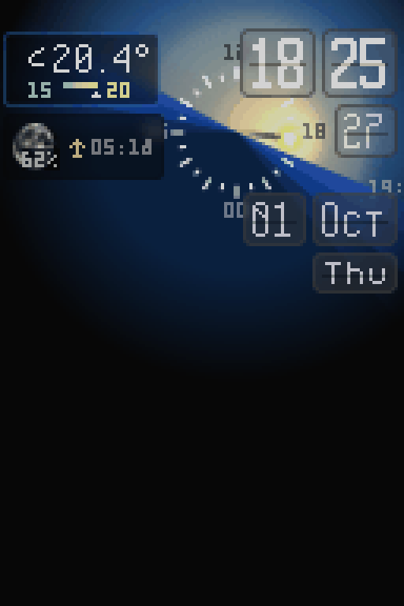

📸 [`assets/disinfo-export.gif`](assets/disinfo-export.gif), rendered 2026-10-01: 10 s at 25 fps, after a 20 s warm-up, at real speed.

Branch [`llm-v1`](https://github.com/prashnts/disinfo/tree/llm-v1), created 2026-09-27 from [`299bdf0`](https://github.com/prashnts/disinfo/commit/299bdf0). The work on this branch is AI-assisted (Claude Code).

### Added
- (uncommitted, 2026-10-24) Design system demo (`apps/design_demo.py`, replaces the flex demo): tabs flex, grid, stack, type, box, motion, scroll, media and touch, full width below the time (`compositor.below_time`, above it when the time is down). Tabs and page numbers are touch targets (action `design_demo`, its payload merged into `RuntimeState.design_demo`): pages cycle every 10 s, a touched one stays until touched again; the next pages fill the room below it. `show_design_demo` replaces `show_flex_demo`, the remote has a button per tab. Written up in `docs/design-system.md`. Test: every page fits its room at 118x94.
- (e201a92, 2026-10-24) `SlidesStyle(edge=...)`: slides come in from an edge instead of fading; `edge='bottom'` without a height is a ticker. The printer card's stage, job and stats roll up like that on a scrim over the camera, which now stays on while printing and 15 min after.
- (uncommitted, 2026-10-23) Web layers `planes` (off: no planes, trails or tap targets, map and sky) and `info` (off: no rings, spokes, airports, landmarks, compass, numbers or halos on the map; no compass letters, airport codes, numbers or the ring in the sky): planes and trails alone are `info` off. Tests in `tests/test_aviator.py`.
- (uncommitted, 2026-10-23) Overhead is now about reach, not elevation: `utils.closest_approach` gives `reach` = hypot(distance at the closest approach, altitude / 2); a plane is overhead within `overhead_km` = 3.5 of it (altitude counting a quarter: right over at 12 km = 3 km), now or within `lookahead` 90 s, its card staying `passed_for` 30 s after it; the first try (8 km, altitude half) kept a plane overhead 100% of the time, so the solar view never showed and the cards rotated; 3.5 km gives about the old share (measured on the live feed over two 2-minute samples); the order of the overhead planes no longer changes while they stay overhead (before: elevation >= 60 degrees, which skipped low planes passing close and took high ones passing 7 km away at 12 km). The overhead list is the nearest first. When no card is on top the nearest overhead plane is framed anyway (`app.following`, kept while it is overhead; no zoom sweep, `_swept` now also checks the plane); framing keeps home in the clear box when plane and home fit at the resting scale (`app.framed`), else it is on the plane.
- (uncommitted, 2026-10-23) The sky has stars (the brightest real ones: Orion's belt, the Big Dipper, Cassiopeia, ~30 in all, and 140 faint random, placed from the sidereal time; fading in with the sun under -3 degrees, dimmed by cloud), the moon (position from suncalc, phase from the mean synodic month, lit side right when waxing, dimmer by day), the satellite's cloud cover as the cloud when Home Assistant has no weather state, and the sunset on the roofs: the roofs facing the sun get a warm rim and a few windows catching it (`aviator/astro.py`, `sky.py`). 2 ms per frame. Tests for the stars, moon and `skylook`.
- (uncommitted, 2026-10-23) The sky view's colours come from the sun's height, the weather state and the room's light (`aviator/skylook.py`): a zenith/horizon gradient by sun altitude (night, a purple-pink twilight, an orange horizon at sunset, a day blue; own palette, cpt-city was down), greyed and darkened by the HA weather state (cloudy, fog, rain...), a haze band over the horizon (high in a fog), the sunset's glow around the sun's bearing and its dimmer reflection under the horizon, and the whole sky 55-100% as bright with the ambient light sensor (3-400 lx, `ambient_light_sensor`). Replaces `solar.sky_color` there. 2 ms per frame (128x192).
- (uncommitted, 2026-10-23) The warning line on the weather card had two missing glyphs in the bitocra7 font (→ and °): `jusqu'à 16h`, `15h-17h`, `Min 2C à 6h`.
- (uncommitted, 2026-10-23) The data service no longer refetches the weather at every restart: `cached()` (`drat/data_service.py`) records each fetch's last success in Redis (`di.dataservice.ran.<name>`, written only when the task returns True) and the first run of all jobs skips those whose interval has not passed since (radar 5 min, satellite 10, vigilance 15, wind and forecast 30); the data they wrote is still in Redis under its own expiry. The planes (1 s) and the metro are unchanged. Tested with a fake task (fresh skipped, stale run, failure not recorded).
- (uncommitted, 2026-10-23) Rain and clouds in the sky view (`sky.py` `rain`, `clouds`; `weather.sky_profile`): the radar and the satellite are sampled once per update along 120 bearings and a few distances (rain 8-80 km, clouds 10-100 km). Clouds: a grey band over the horizon as high as the cover is thick in each direction (the sun's glow dims behind it); rain: curtains hanging from 4 km up in the directions it rains in, the nearer higher and stronger, and a few drops across the view when it rains at home. The web layers `rain` and `clouds` switch them. Bench (PC, 400x300): 0.3-2 ms per frame, the profile table is built once per update. Subtle today (clear sky, rain 50+ km WNW); not seen on a display.
- (uncommitted, 2026-10-23) Wind on the radar map: Open-Meteo's Météo-France models (AROME, no key), a 7x7 grid over ±150 km in one request every 30 min (`weather.wind_job`), drawn as faint arrows (alpha 0.25) on a regular 34 px screen grid, the wind bilinear from the grid and turned with the map, inside the basemap's cached image: no extra redraws (an animated version, continuous then pulsed, was tried and dropped: it raised the radar's redraws from 1/s to 2.6-5/s). Web layer `wind`. Bench: the arrows cost 0.4 ms at 266x160 and 3.7 ms at 800x480 per basemap repaint, 0.1 ms at rest.
- (uncommitted, 2026-10-23) The weather card's warnings are one scrolled line in the card's own width (`HScroller`, so the card no longer changes size): Vigilance lines, then the next rain and the lowest temperature of the next 12 h at home (`vigilance.forecast_job`, Open-Meteo/AROME hourly, every 30 min; `Pluie 15h → 17h 2mm/h`, `Min 2° à 6h` when ≤ 5°).
- (uncommitted, 2026-10-23) The radar map has a half-transparent Material-style compass, bottom right, its red needle turned to north as the map is (`aviator/app.py` `compass`; 6% of the short side, 6–13 px).
- (uncommitted, 2026-10-23) Météo-France Vigilance on the weather card (`screens/weather/vigilance.py`, key `meteo_france_api_key__vigil`, `vigilance_domain` = '75'): the data service reads the vigilance map every 15 min, keeps the département's phenomena past green in Redis `di.weather.vigil`, and the card (`weather/app.py`) shows under the temperatures, coloured, a line per phenomenon still to come: rain, snow/ice and cold from yellow, the rest (wind, storms, heat...) from orange, e.g. `Vent orange → 16h` (tested on today's storm bulletin). One Redis read per minute, one small text frame: no measurable cost.
- (uncommitted, 2026-10-23) Clouds on the radar map: EUMETSAT's EUMETView WMS (MTG infrared 10.5 µm, Meteosat 10.8 as fallback, no key, credit EUMETSAT), 300x300 over ±150 km every 10 min (`weather.sat_job`), the grey stretched to a translucent white drawn first, under the land, in the basemap's cached image. Web layer `clouds`. Bench (basemap repaint, PC): 9.9 → 10.7 ms at 266x160 and 18.9 → 24.6 ms at 800x480 with clouds, rain and wind together; at rest 0.08 / 0.12 ms.
- (uncommitted, 2026-10-23) Wind on the radar map: Open-Meteo's Météo-France models (AROME, no key), a 7x7 grid over ±150 km in one request every 30 min (`weather.wind_job`), drawn as arrows on a regular screen grid with the wind bilinear-interpolated, in the basemap's cached image. Web layer `wind`. Bench (basemap repaint, PC): 266x160 9.4 → 10.1 ms with rain+wind (wind alone ~+0.7), 800x480 18.5 → 23.8 ms (+5 ms, the arrows are a Python loop, ~400 of them); at rest 0.1 ms either way.
- (uncommitted, 2026-10-23) Rain on the radar map (`aviator/weather.py`): the Météo-France radar mosaic (API Données Radar, `meteo_france_api_key__radar`, Licence Ouverte, credit Météo-France), fetched every 5 min by the data service, resampled on the radar's km grid (±150 km, 1 km/px, ODIM HDF5 via h5py/numpy/pyproj, 0.15 s) and painted translucent in the basemap's cached image, so it costs nothing while the view is at rest. Web layer `rain`. Bench (basemap repaint, PC, 266x160 / 800x480): 9.7 → 10.1 ms / 19.2 → 19.3 ms (+0.3 ms); at rest 0.08 / 0.12 ms either way; the rain image is built once per update: 5.7 ms.
- Screen data (`config/screen_data.json`, shared by all the screens, `app_config.screen_data`; `DI_SCREEN_DATA_PATH` to move it): the landmarks visible from the window. The radar marks them as small translucent dots, 4 px close to 1.5 px at 20 km, growing with the zoom (uncommitted).
- The radar has a land map under it (`aviator/basemap.py`, from `osm.py`): greenery, water (rivers, coast), built-up areas and motorways from OpenStreetMap (Overpass, `overpass_url`), asked once per place and group, cached in redis for 90 days, fetched in a thread one group at a time (the map fills in). Shapes are simplified, snapped to 45 degrees (`shapes.py`) and rounded; translucent, the more significant over the less (builtup < green < water < lines), the bigger ones under the smaller. It works at any home. `basemap.styles` and `basemap.sources` are where metro lines go. Drawn once per view (0.05 ms at rest; 25 ms for a 128 px view the first time with the 28k points of Paris greenery, 45 ms at 800x480) (uncommitted).
- `Resize` (discore) blends one value for another instead of fading the two over each other: a card whose route or photo comes in no longer dips to 75% opaque (and dark) half way, which looked like a blink, twice (uncommitted).
- The radar map draws about 3x faster while the camera moves (32 to 11 ms for the Paris data on 128x192): the cairo paths are encoded once, the culling does its arithmetic inline, the specks under 1.5 px are skipped; each screen keeps its own drawing (two screens of one size, as in maindev, redrew the map at every frame) (uncommitted).
- Layers of the radar map (builtup, green, water, roads, transit) switch on and off from checkboxes on the web page, next to the light map one (`aviator.layer`, kept in redis `di.aviator.layers`, read back by `/aviator/settings`). The checkboxes show what is set when the page loads (uncommitted).
- The radar map has the metro and RER lines (`osm.lines_of`, group `rail`): the routes of a line joined into one path in its OSM colour, a dot at each end that is not on another piece of it (no stations). `route=subway`, and `route=train` named RER or S-Bahn (uncommitted).
- The plane cards and the tile follow the radar's light mode (`widgets.Look`, `dark` and `light`): the texts darker, on a paler card (uncommitted).
- A light mode for the radar map (`aviator.light`, a "light map" checkbox on the web page, kept in redis `di.aviator.light`, on every screen): the dark one inverted on a medium grey (about 0.6 at the center, not a light one: an LED panel): dark grid, labels and halos, the map's tints deeper and more saturated (`app.Theme`, `basemap.light_styles`). The sky and solar views are unchanged (uncommitted).
- The radar's map and zoom per screen (`aviator.map_up`, `aviator.zoom`) are kept in redis (`di.aviator.map_up`, `di.aviator.zoom`) and survive a restart, like the view, radius, trail and altitude already did. The map shapes are simplified per kind, the built-up areas the most (0.6 km); cached ones too, on load (uncommitted).
- Cards take turns fairly (`discore.stack`): moving on, a stack shows the card on top least lately (time on top fading by half over 10 minutes; a card starts level with the least shown when it appears, the ones gone are forgotten once faded; between equals, another than the one on top), whatever moved it on: its wait, a press, a motion. A short card stays on until it's had its share. Over time each card gets about the same; a plane passing overhead (a new card) or one tapped still comes first. Someone moving by (a screen's presence sensor turning on, at most every 10 s) moves the stacks on (uncommitted).
- Fades: the backgrounds share one (`FadeIn('background')`): switching between the solar clock, the map and the sky, the new one fades in over the last. The entry screen is dimmed while nobody's there (the Guition's off then, a touch lights it) and fades up when someone comes (uncommitted).
- `discore.widget`: `background=`, the background a widget brings while it's on top of its stack (`Stack.current`); the screens build their stacks first and show what the cards on top ask for. A plane's card or the planes' tile on top brings the radar (the map or the sky), the solar clock otherwise; the sky view stays up (it has the sun). The `solar` view offers only the cards of the planes passing overhead (or tapped). The entry screen fits 266x160 (3x on the Guition: fewer pixels to compose and send): smaller buttons, the time at 1x (uncommitted).
- A screen for esp-displays' T4-S3 (`di_pcstate`, 200x150, 3x on its 600x450 AMOLED, over USB): its own composer, the same sensors. The web server serves any screen to such displays: `/display/<screen>/stream.mjpg` (the newest frame, a whole-number scale to fit `w`x`h`), `/buttons` (shown on the display), `/press`.
- Music slides, with album art cached and a Spotify mark ([`6ce6bbb`](https://github.com/prashnts/disinfo/commit/6ce6bbb)). Listening sessions (`utils/sessions.py`, [`d2d38aa`](https://github.com/prashnts/disinfo/commit/d2d38aa)).
- GIF renderer: `--fps` and `--warmup` options (uncommitted).
- **`/ws2/<screen>`, frames pushed to the panels** (uncommitted). Binary messages, a header (`seq`, `base_seq`, a box, an encoding) and the frame: raw RGB + zlib (`rgbz`), `png` or `rgb565z` (`?fmt=`). A frame is sent when it changes; a slow client skips to the newest. **Only what changed is sent**: the server keeps a screen's last 8 frames, compares the client's frame with the newest on 16x16 tiles, and sends the changed tiles, merged into boxes, in one message (the client applies them together, never showing half a frame). A whole frame when more than half changed, or the client's frame is older. Telemetry goes up as text, acts come down as text, `{"alive"}` every 2 s when nothing changes, `{"resync": 1}` asks for a whole frame. `base_seq` is 0 for whole frames: regions of a frame can follow without changing the clients. `/ws` stays as it was. `disinfo/transport.py` has the formats.
- The web page shows the screens over `/ws2` (PNG), on canvases: whole frames, then the regions that changed, decoded before they're drawn (uncommitted). Touches on a canvas go to the screen.
- **Touch** (uncommitted). `discore` frames carry touch targets (`Target`: a box and an action), placed by the layouts (stacks, flex, div, `composite_at`, `place_at`, crops and scales; a transition's once it's done). `discore.button`: a styled div, touchable all over, pressed style. Clients send `{"touch": [x, y, "down" | "move" | "up"]}` over `/ws2` in the frame's px; the server finds the target under it (the renderer publishes them on `di.pubsub.targets`), shows it pressed (`di.pubsub.touch`), and does its action when let go on it: `ha.call` calls a Home Assistant service from the server, anything else goes out as a remote action.
- `dientry`, the entrance's screen (400x240, for an 800x480 panel at 2x): the solar clock behind, the time, weather, moon and the music playing (the 128 px panels' cards at 2x, sharp, their buttons too); along the bottom the scenes lumos, dodo, soir and nuit (the last one turned on marked) and the mirror's light (lit when on) to touch (uncommitted).
- The music card shows whichever player is playing (the speaker's first), with play/pause and next to touch (uncommitted).
- Scrollers carry their content's touch targets, moved with it, the ones in view: buttons in a `Stack`'s cards work (uncommitted).
- ESP displays' sensors (telemetry over `/ws2`) go to Home Assistant as `sensor.<screen>_<reading>`, with units and device classes, set over its REST API (`utils/ha_states.py`; the BME680's -1 °C as ESPHome had it). The Guition's go to the ids ESPHome gave them (`sensor.guiton_bme680_*`, `sensor.guiton_ens160_*`, `sensor.guiton_dientry_*`): their history and statistics go on (uncommitted).
- `/ws2` sends the time first (`{"time"}`): displays without NTP (over USB) set their clock from it (uncommitted).
- `disinfo.bench --at "2026-10-19 17:00"`: the screens' clock from that time, so runs compare (the day changes the content, and with it compose and transport) (uncommitted).
- `config/di2_entry.conf`: the entry screen's renderer for supervisor (uncommitted).
- The renderer publishes whether someone's there with the touch targets (`awake`, its presence sensors); `/ws2` tells displays `{"display": {"on": ...}}` to turn their backlight on or off (uncommitted).
- The HUB75 websocket client speaks `/ws2` with `"protocol": "v2"` in its config, telemetry at `telemetry_hz` (30) (uncommitted). v1 stays the default. Whole frames and regions are put together in `websocket_rpi_matrix/frames.py`, which has no hardware imports.
- Tests for the transport, `tests/` (uncommitted): the formats, regions applied by the client (in place, chained, for a frame it doesn't have), `/ws2` end to end (a whole frame on connect, changes pushed, identical frames skipped, resync, acts, PNG), `/ws` and `/png` from the same frame, the renderer skipping unchanged frames, and the server still receiving frames after a bad message. CI runs them with the `discore` tests.
- **Aviator, redone** (uncommitted). The data service polls the tar1090 receiver (`adsbx_url`) every second and keeps a table of the planes within 60 km in Redis (`di.aviator.table`: 10 minutes of trail, the closest approach, bearing and elevation from home); cartopy and geopy are gone (a flat projection). The planes seen from the window (`aviator_window`, nearest first, a plane keeps its card while seen) or about to pass overhead get a card in the bottom stack: route (adsbdb), photo (planespotters, on the card on top only), where to look (`NE 19°`), altitude, speed, type. The radar replaces the solar clock while there's something to see, a queue at CDG/ORY/LBG or a card open, never in `aviator_quiet` (06:00–07:30): the window's slice of the sky, or the airport, on a grey scope, the card on top's plane lit, zoomed on, kept out from under the cards. `aviator_map_up` turns a screen's map; the web page sets the radius (`di.aviator.radius`). On the salon, desk, display and entry screens, which share their background and cards now (`screens/common.py`); the entry screen is laid out like the salon's. Composers keep touch targets (tap a plane, a card). `discore`: `Stack.current`. Tests: `tests/test_aviator.py`.

  Then: a full card only when tapped or passing overhead; the other planes seen from the window are numbered on the map (pills in their altitude's color) and scroll by in one tile with the same numbers. The radar layer is redrawn 5 times a second, every frame only while its camera moves: the displays get small changes instead of whole frames (the Guition struggled). **Sky view** (`aviator/sky.py`, `aviator_view: sky` or the web page's map/sky buttons): out of the window from home, a forced perspective (bearings across, the elevation stretched near the horizon, the ground under it with the rings, a stalk down from each plane seen), the sun where it is in the solar clock's sky colors; it's always on (outside the quiet hours), the solar clock and the planes together.

  Later: **the sky view** shows a quarter of the compass (90°), turned towards the planes seen from the window and held still until they move a quarter view away; only the numbered planes in full (fainter trails), the others as dots; a drawn Haussmann roofline (two rows of six-floor blocks with mansards and chimney pots, seeded: always the same; pixel-crisp) with landmarks where they stand from the window (the Mercuriales towers, the Vincennes keep, Sacré-Cœur, Tours Duo, the BnF, Montparnasse, the Eiffel Tower), from `aviator_eye_m` (35, the 11th floor) over the street; low planes go behind the roofs, their numbers stay on top. Plane cards come after the other cards and take the stack only when tapped (they kept the printer's card from showing). A third view, `solar` (the solar clock, no planes behind), from the web page's map/sky/solar buttons or `aviator_view`; the displays' **Radar** button goes map, sky, solar in turn. Slow motion: while nothing's followed the map wanders a few pixels about its middle and breathes (2–3 minute cycles), the sky view's heading sways a few degrees; redrawn once a second, a small change for the displays (entry: 5.7 % of the frame a frame on the map, 3.9 % sky, 3.8 % solar). The map's angle can be set per screen from the web page (until the renderer restarts). The distance is back on the cards and the tile. Airport labels don't overlap (another side, or none). The map's background stays dark grey, without the lighter window half. The radar layer is redrawn once a second when still, 12 times a second while its camera moves (it moves only to put the followed plane back in view, zooms once per plane, 4 s); the trails fade in 15 s steps; the entry screen's cards are 1x (2x on the Guition). **Fixed**: a renderer crash when a scroller's content got shorter than where it had scrolled to (`discore.scroller`, the salon restarting); the pub/sub thread dying when a state manager attached while a message came in (`drat/app_states.py`).

  | 2026-10-20, `--at 17:00`, compose median (p90) | salon 128x192 | display 200x150 | entry 400x240 |
  |---|---|---|---|
  | radar off (`aviator_quiet` all day) | 10.0 (11.5) ms | 10.4 (12.0) ms | 11.5 (13.0) ms |
  | radar on, 2 cards | 10.1 (11.6) ms | 10.7 (12.0) ms | 13.0 (14.2) ms |

- **Screen layouts** (`discore.screen`, uncommitted). A `Screen`, set up in code like a widget, names its items and the choices of where they may go (`Option`s putting items on `Spot`s: an anchor, an offset, a jitter rolled at each relayout; a penalty; `when` a condition holds). Every second each arrangement is scored on a 4 px grid: what has to stay in sight (`Focus`: the solar clock, or the planes on the map and sky, the followed one most, then the numbered ones) under the items that count (`covering`: the cards, not the time), each item's share under the others (`stacked` items, the stacks, may share a corner; anything that shows counts, a frosted card too), items off the screen, how long each item's spot has been lit (burn-in: a heat map fading by half over 12 h, against the most worn spot or an hour at least, kept in Redis `di.screen.heat.<screen>`), and the penalties. It changes when someone comes (presence), every 15 minutes, or anytime the current one gets much worse (a plane going under a card); the items slide there (0.8 s). `Layout.clear`, the largest box the items leave free, is where the radar keeps the followed plane. All four screens have one: the salon, the desk and the display (`compositor.big_screen`: the side stack on its designated side, left, the desk right; the time and date in the top corner across from it, on the stack's side for a penalty, at the bottom only while calm: nobody there, or a plane's card on top; `time_side=` keeps the time on one side) and the entry (`screens/entry.py`: the side stack top left or right, the time across, the buttons where they are). The solar clock goes across with the side stack. The compositor finds a screen's composer through it (`SCREENS`). They replace the random offsets every 15 s (`p_stack_offset`, `p_time_offset`; the solar clock keeps its). Simulated over 3 days with 8 h asleep a day: a move about every 40 minutes; the side stack off its designated side 22 % of the time on the salon, 42 % on the desk, 24 % on the display, 23 % on the entry; the time and date in all four corners while calm. Tests: `libs/discore/tests`, `tests/test_screens.py`. `python -m disinfo.sim_layout <hours> <asleep hours a day>`: a screen's layout over simulated days (its real items, a fake clock).
- **Grid layout**, `discore.layouts.grid` (uncommitted): `nrows` and/or `ncols` (one given, the other follows; both, the overflow takes rows; none, about square), each column as wide as its widest, each row as tall as its tallest, `anchor` in the cell. `masonry`: each item under the shortest column. `width`/`height`: the columns (rows) share it, growers fill their cell, the rest is clipped, touch targets too. The flex demo has tabs now, flex and grid (touched, or `layout_demo_tab` from the web page), with grid slides: the shapes, rows against masonry, a breathing width, the anchors.
- The entry screen's Home Assistant buttons (uncommitted): one list (`BUTTONS`: label, entity, icon, `big` or `pill`), the action by the entity's domain (a scene turns on, a button presses, the rest toggle); big tiles (the icon over the label) and pills, in a masonry of up to 3 columns, fewer when it's narrow. Icons from Material Design Icons (`utils/mdi.py`): downloaded one svg at a time into `assets/mdi` (check them in), kept in memory when that can't be written (the image's assets); a toggle off shows its `-outline` icon if it has one. Button entities are pressed by holding them 5 s: the button fills as it's held, the screen's edge gets a yellow and black border, its thickness pulsing; the server does the action once the touch stayed on it that long (`Target.hold`, `discore.button`'s `hold` and `progress`).
- Aviator (uncommitted): `show_planes` on the web page hides the plane cards, their planes go first in the tile (the solar view then shows the tile too). A zoom per screen on the web page next to the map's angle (`aviator.zoom`, or `aviator_zoom`): out, the view comes to home, all around it.
- Aviator, three sliders on the web page (uncommitted): the radar's trail length (1-10 min, 3 by default; the planes with a card show their whole approach), the highest altitude shown (500-13000 m, the top is no filter: the poller leaves the planes above it out of the published table and its scenes, but keeps tracking them), and the map's zoom and angle for all screens (`all`, the default, or one; a screen set after keeps its own). Measured on the desk (`.config-didesk.json`, 128x128, a real table of 32 planes, fixed clock): compose 11.1 ms with 3 min trails, 10.8 ms with 10 min (the trail is a few strokes a plane; the redraw is by fade step, 1.9 KB of regions per frame either way).
- The desk's date goes in the time's row only when it would be covered (`compositor.DATE_BESIDE`, item `timedate`, now +1.2: the burn-in heat counts per item, so one item less was cheaper and the desk kept the date beside the time with room below): below the time as before otherwise. Compose is still 11 ms with the doubled choices.
- Benchmark, `python -m disinfo.bench`: composes the configured screens at their size or the `--size`s given (forced awake, paced like the renderer, nothing published), then times today's transport (PNG + base64, decode + JPEG). Each run appends to `bench.jsonl` with the commit and a `--label` (uncommitted).
- Docker image (`Dockerfile`, [`3c93d89`](https://github.com/prashnts/disinfo/commit/3c93d89)): `app` target, and a `demo` target with Redis and the sample config in one container ([`d0297a8`](https://github.com/prashnts/disinfo/commit/d0297a8)). The demo also runs `config/fake_server.py`, a tiny stand-in for Home Assistant (websocket: presence, light, weather and forecast, sun, moon, a playing speaker) and the ADS-B feed, so it shows weather and music without a home. Kagi news stays real (uncommitted). Fonts are fetched at build time, not on every container start, and Noto Color Emoji is installed from apt so `render_emoji` draws real emoji instead of a fallback box (uncommitted).
- Small pixel fonts with French accents, between Microfont (5 px caps) and Greybeard 11 (8 px): Galmuri 7, 9 and Mono 9 (OFL), Fusion Pixel 8 px (OFL), PxPlus HP 100LX 6x8 (CC BY-SA), in `fonts.py` with their sources (uncommitted).
- Font licenses, `assets/fonts/LICENSES`: the license texts (OFL, MIT, BSD, Tamzen, CC0, CC BY-SA, CC BY-NC) and a README listing every font file with its author, terms and source; the free ones without a license text are marked link only (uncommitted).

### Changed
- **`discore`**: the layout, text, scroller, sprite, stack, transition and widget components moved into their own package, `libs/discore`, with tests ([`e07faf9`](https://github.com/prashnts/disinfo/commit/e07faf9)).
- **Docker images are built when a `v*` tag is pushed**, no longer on every push to `master`. A tag `vX` publishes `ghcr.io/prashnts/disinfo:X` and `:latest`, and `:X-demo` and `:demo`. The per-commit `sha` tags are gone (uncommitted).
- CI is split: `test.yml` runs the `discore` tests on every push, and `docker.yml` runs the full app tests (and a render smoke test) before building (uncommitted).
- **The renderer publishes raw frames** on Redis `di.frames.raw` (outside `di.pubsub.*`, whose subscribers read JSON): RGB + zlib, no PNG, no base64 (uncommitted). Unchanged frames are not published, but resent every second. The server keeps the newest frame of each screen and encodes it once per format for all clients; `/ws`, `/png` and the MJPEG stream use it. Renderers still publishing PNGs on `di.pubsub.frames` (hub75, udp, sixel, frekvens) work as before.
- The MJPEG stream is decoded in `utils/mjpeg.py`, with a lighter printer card ([`beb38c2`](https://github.com/prashnts/disinfo/commit/beb38c2)).
- **`discore` frame hashes are never computed from pixels unless asked** (uncommitted). A `Frame` without a hash used to hash all its pixels in the constructor (0.6 ms for a 720p image), even when `.tag()` replaced that hash right after, as the compositor does for the whole screen on every frame. Now it gets a token, equal only to itself. Hashes say what a frame shows: derived from the operation and its inputs, or from the source's identity; `Frame.of_pixels` hashes the pixels on request. `Frame.fallback` is hashed by its size. Given derived or source hashes: the scrollers' padded frames (they're rebuilt on every `set_frame`, a token there would restart the transitions around a scroller on every frame), `VisibilitySlider`, the transitions' blank frames, album art and metro icons. Checked by counting transition restarts over 240 frames on `di_pcstate` and the `disalon` layout: the same for every transition as with pixel hashes.
- **`uname` reads the caller's frames with `sys._getframe`**, not `inspect.stack()`, which built a record of every frame on the stack and looked up its source file (uncommitted). 870 µs → 0.85 µs a call; awake, a frame makes about a dozen. The names are the same: checked against `inspect.stack()` on every call over 240 frames of `di_pcstate` and the `disalon` layout (about 1,400 calls each, no difference), and no name was used twice in one frame.
- Named what relied on arguments alone to stay apart (uncommitted). Scrollers and transitions are scoped instances keyed by their arguments; without a `name` two equal ones are one instance with one state. The stacks' scrollers are `<stack>.scroller`, and the news deck's scroller and five transitions are `news.deck.<part>` (one was a bare `Resize()`, shared with any other on the screen).
- Cards take turns by their share (`Widget.share`, 1 by default): a stack weighs each card's time on top against it. The weather card has 3. With equal time it had a quarter of the side stack and came back once every three or four rounds of the short cards (moon, trash, the recent music): 83 turns an hour against their 290 each. Now it has half, back about every round (163 turns, 195 each), simulated with the stack over an hour (uncommitted).

### Fixed
- (uncommitted, 2026-10-24) The buzzer (HUB75 client) plays in its own thread: its tones blocked the sensor loop, so no input (the dial) while a melody played, and a rest lasted until the next loop to keep that short. Now rests wait (the family mart tunes keep theirs at ~60 ms, one sensor loop, as they sounded), the sensors don't (desk, telemetry every 58 ms median, 93 ms at most, playing or silent). An act's command can be a list of sounds played as one (`act(fs, 'buzzer', ['fmart', 'boop'], pk)`); the same sound and hash again while it waits or plays is dropped, and at most 3 wait. The siren plays (its notes are frequencies, it raised a `KeyError`). The timer sends its end once, when it ends (it sent melody, boop, rest each frame from 7 s before, for one to get through), and the down button boops on press, not each frame it's held.
- (uncommitted, 2026-10-24) Acts (the buzzer) got lost on their way to a display. On `/ws` (the HUB75 panels) each telemetry message, the one asking for the next frame, emptied the screen's acts before the frame went out with them: what came in between two frames was dropped, all of it once the renderers published raw frames. On `/ws2` one shared list was swapped from the event loop while the pubsub thread appended to it, the first client on a screen took the acts from the others, and acts waited behind frames. Now each screen keeps its acts with an id for 10 s (`ACTS_TTL`), each connection sends the ones it hasn't (`acts_id` next to `acts`), `/ws2` before frames, and `?since=<acts_id>` on both picks up after a reconnect (a new connection gets the acts from then on). The HUB75 client hands acts to the sensor thread through a `deque` (they could be lost between its copy and reset), reconnects with `since`. Desk, 'ok' beeps over `/ws` from a server on the PC: 0 of 10 played before, 10 of 10 and 30 of 30 (0.4 s apart) after, old and new client.
- (uncommitted, 2026-10-24) `place_at` and `composite_at` hashed their result by the frame placed only: the same card over another picture, at another place or frost, had the same hash (a stale picture for anything caching by it). Now by what's under (its hash, an image's size), where and how. Bench (pcstate, fixed clock) compose 8.9 / 16.2 / 26.9 → 8.4 / 16.1 / 26.6 ms at 200x150 / 800x480 / 720p: unchanged.
- (e201a92, 2026-10-24) `SlideIn` between frames of different sizes: it moved by the new frame's size instead of the old one's and jumped at the end; while it moves it's as tall as the taller one.
- `discore.screen`: the desk's layout swapped sides every few seconds while plane cards showed (uncommitted). Two causes. The planes' focus is the radar as drawn for the current arrangement, and the radar re-frames the followed plane after each move, so the one just left always looked better: a focus that follows the layout (`Focus(follows=True)`, the planes) counts only on relayout now. And the stacks' cards cycling and sliding (a narrow plane card, then a full-width one, over the date) flipped the best arrangement each time: in between relayouts, the current one has to be much worse for 30 s (`anytime_s`) before it moves. Desk with two plane cards open, real time: 18 moves in 90 s before, 1 in 180 s after. Simulated 3 days: 97 moves, off its side 33 % (was 42 %).
- `discore.stack`: a card whose picture changed counted as just added and took the top; cards are told apart by name (uncommitted).
- `discore.transitions`: a new value in the middle of a transition restarts it from its start (it went on from where the last one was, the new frame jumped in), and a fade cut short fades from what it was showing (it jumped back to the frame before). A settled fade returns its frame without blending it again (uncommitted).
- Font licenses in `fonts.py` that the font files contradict: Gaiatype is CC BY-NC-SA (was CC0), aztech CC BY-SA (was CC0), Mecha, Extremely Small Fonts and Small Pixel CC BY-SA (were free / free (nc)), 15x5 CC BY-NC, PixelPlay CC BY-SA, Long Pixel-7 personal use (uncommitted).
- CI tests: `apt-get update` before installing system libraries, fonts fetched once before the render smoke test, the smoke test waits for the server instead of sleeping 5 s, and stops it afterwards. A server left running held the uv cache lock and hung the job's post-step for minutes (uncommitted).
- `/ws2` no longer waits up to a second for a frame that came while it was sending the previous one (uncommitted).
- The server's raw frame subscriber kept running after an error in its callback, instead of dying with it and leaving the server without frames (uncommitted).
- One Ctrl+C stops the renderer again, and `maindev.py` with it (uncommitted). The painters of `draw_loop` were not daemon threads since [`1a9759e`](https://github.com/prashnts/disinfo/commit/1a9759e), so Python waited for them at exit; the news highlights' extraction thread neither.
- `/ws` returns when the client disconnects, instead of logging a traceback (uncommitted).
- The Home Assistant client printed its auth message, access token included, when connecting (uncommitted). It leaves the token out now.
- GIF renderer timing (uncommitted). Each frame now lasts as long as it took on the wall clock, in milliseconds. The delays used to be passed as `durations=` (which Pillow ignores) and were computed in seconds ÷ 1000, so every GIF from 2023 to 2026 has 0–10 ms frames and plays too fast.

### Performance
Measured with `disinfo.bench` on `di_pcstate` (awake, 120 frames at 12 fps), at 200x150 / 800x480 / 1280x720. Compose is the median.

| Change | Compose (ms) | Transport encode (ms) | `Frame` of a 720p image | `uname()` |
|---|---|---|---|---|
| Baseline, 2026-10-19 (`07a4dc6` + the uncommitted flex layout) | 21 / 33 / 60 | 6 / 39 / 70 | 0.6 ms | 860 µs |
| Frame hashes: tokens by default, no pixel hashing | 20 / 32 / 56 | 6 / 38 / 68 | 0.2 µs | 870 µs |
| `uname` on `sys._getframe` | 10 / 25 / 49 | 6 / 38 / 69 | 0.2 µs | 0.85 µs |
| Raw RGB + zlib instead of PNG + base64, unchanged frames skipped | 11 / 27 / 53 | 0.7 / 3.0 / 6.1 | 0.1 µs | 0.81 µs |
| Touch targets in the layouts, scrollers; at 22:32 (a lighter screen: PNG 112 KB at 720p, was 254-296) | 8 / 23 / 44 | 0.3 / 1.7 / 3.4 | 0.2 µs | 0.87 µs |

| 2026-10-22, `--at "2026-10-19 17:00"`, compose median (p90) | salon 128x192 | desk 128x128 |
|---|---|---|
| Before the screen layouts | 13.9 (15.0) ms | 12.9 (14.2) ms |
| Screen layouts, salon and desk (`Screen.arrange` 0.3 ms a frame, 0.7 ms with its scoring once a second) | 12.2 (15.8) ms | 11.4 (13.3) ms |
| Screen layouts on all four screens (display 200x150: 11.0 (13.0) ms, entry 266x160: 9.4 (11.2) ms) | 9.8 (11.7) ms | 9.3 (11.1) ms |

On the full study layout at 60 fps the desk got about 36 changed frames a second, 19 KB each (~700 KB/s), when 6% of the 16x16 tiles changed (median). With regions: 9–74 KB/s depending on what moves (0.7–2.5 KB a message, a whole frame when a slide changes), no resyncs; the frame a client puts together is the server's. Finding the regions costs 0.1 / 1.4 / 2.6 ms a frame at 128x128 / 800x480 / 720p.

| Change | Changed frame sent (KB), 128x128 / 800x480 / 720p | Whole frame (KB) |
|---|---|---|
| Regions, from the benchmark (consecutive frames at 12 fps) | 6.7 / 6.2 / 5.7 | 18 / 138 / 265 |

The disinfo desk (Pi 4, 128x128) on the same PC server, `/ws` then `/ws2`: client CPU 124% → 59%, 686 → 25 KB/s received. Renderer and client at 60 fps instead of 40: 19 changed frames a second instead of 13, the client at 64%, the renderer at 31% of a core.

## [2026.08.15] - The panel on the wall

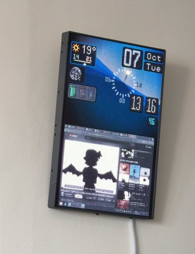

📸 [`output-di.gif`](https://github.com/prashnts/disinfo/blob/605e3ea/assets/output-di.gif) ([`605e3ea`](https://github.com/prashnts/disinfo/commit/605e3ea)), a recording of the real panel.

### Added
- GIF support in sprites, and Nyan Cat on 22:22 ([`dd84b90`](https://github.com/prashnts/disinfo/commit/dd84b90), [`d2e20b0`](https://github.com/prashnts/disinfo/commit/d2e20b0), [`b388aea`](https://github.com/prashnts/disinfo/commit/b388aea)).
- Printer camera stream in the card ([`a241cf7`](https://github.com/prashnts/disinfo/commit/a241cf7)).
- News highlights ([`05946bd`](https://github.com/prashnts/disinfo/commit/05946bd)) and datetime highlights ([`a63ef90`](https://github.com/prashnts/disinfo/commit/a63ef90)). Time-sequence prompt ([`ec842df`](https://github.com/prashnts/disinfo/commit/ec842df)).

> **First use of AI in disinfo** (2026-07-15, [`a63ef90`](https://github.com/prashnts/disinfo/commit/a63ef90)). The datetime highlights' `find_sequences` (`disinfo/screens/date_time.py`: is it 12:34, or 13:13:13?) was generated by local LLMs (nemotron-3-nano among others) from a prompt, which is kept as the function's docstring. The code was written from that prompt in one go, not by AI-assisted editing.
- README rewrite and runtime notes ([`fce8aa7`](https://github.com/prashnts/disinfo/commit/fce8aa7) … [`8248ce7`](https://github.com/prashnts/disinfo/commit/8248ce7)).
- Horizontal stack ([`3feb5af`](https://github.com/prashnts/disinfo/commit/3feb5af)), div sizes and layout ([`7a2872c`](https://github.com/prashnts/disinfo/commit/7a2872c)), blank frames ([`1a9759e`](https://github.com/prashnts/disinfo/commit/1a9759e)). These came after the photo.

### Changed
- Blurs and references are cached ([`ac8d48e`](https://github.com/prashnts/disinfo/commit/ac8d48e), [`97f8eaf`](https://github.com/prashnts/disinfo/commit/97f8eaf)). Perf improvements ([`84aaa64`](https://github.com/prashnts/disinfo/commit/84aaa64)). Client, timer, stack and solar clock updates (2026-05-31 – 06-07).
- Metro disabled for now ([`03e64d6`](https://github.com/prashnts/disinfo/commit/03e64d6)).

### Fixed
- Overzealous image loader ([`47646d9`](https://github.com/prashnts/disinfo/commit/47646d9)). Double timers ([`8a20fc1`](https://github.com/prashnts/disinfo/commit/8a20fc1)). Node names ([`0b990b1`](https://github.com/prashnts/disinfo/commit/0b990b1), [`4fd268c`](https://github.com/prashnts/disinfo/commit/4fd268c)). Music widget ([`299bdf0`](https://github.com/prashnts/disinfo/commit/299bdf0)).

## [2026.03.08] - Richer printer card

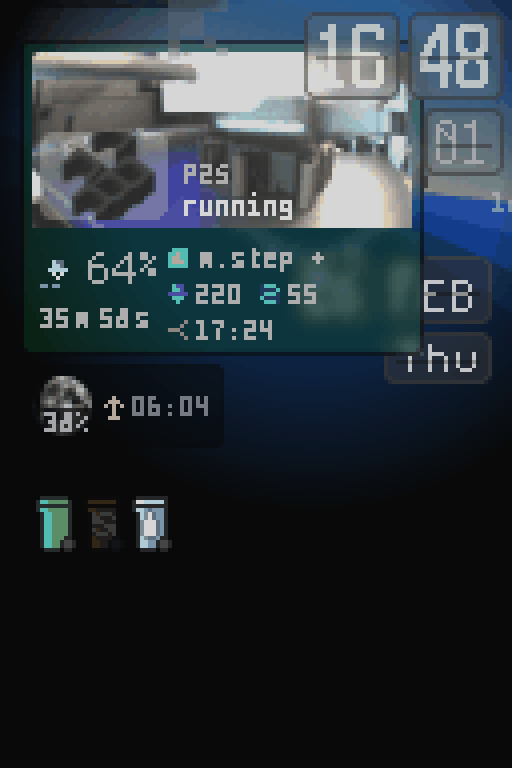

📸 [`disinfo-export.gif`](https://github.com/prashnts/disinfo/blob/5d31841/assets/disinfo-export.gif) ([`5d31841`](https://github.com/prashnts/disinfo/commit/5d31841))

### Changed
- The Klipper printer card shows the camera, progress and temperatures ([`5d31841`](https://github.com/prashnts/disinfo/commit/5d31841) … [`fe79566`](https://github.com/prashnts/disinfo/commit/fe79566)).

## [2026.02.21] - Portrait layout, Home Assistant over WebSocket

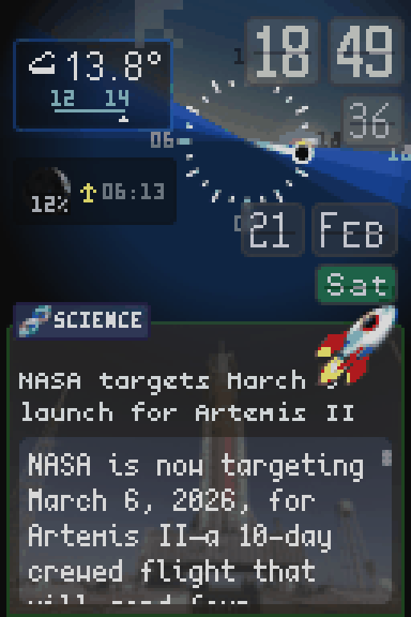

📸 [`disinfo-export.gif`](https://github.com/prashnts/disinfo/blob/5783f4a/assets/disinfo-export.gif) ([`5783f4a`](https://github.com/prashnts/disinfo/commit/5783f4a)), the first export of the 128×192 portrait panel.

### Changed
- Home Assistant over WebSocket (`utils/hass.py`). Weather comes from HA instead of Pirate Weather ([`d209b65`](https://github.com/prashnts/disinfo/commit/d209b65)).
- News: better shuffle, longer display per story, Kagi errors handled ([`e0363b4`](https://github.com/prashnts/disinfo/commit/e0363b4), [`6861753`](https://github.com/prashnts/disinfo/commit/6861753), [`bd67ce4`](https://github.com/prashnts/disinfo/commit/bd67ce4)).
- `mlx` added ([`fdcda78`](https://github.com/prashnts/disinfo/commit/fdcda78)).

## [2025.11.16] - WebSocket panels, remote, frost

No screenshot for this period.

### Added
- 🔧 **WebSocket HUB75 client** (`clients/websocket_rpi_matrix`) ([`28dfd37`](https://github.com/prashnts/disinfo/commit/28dfd37), [`a526c80`](https://github.com/prashnts/disinfo/commit/a526c80) … [`be16db6`](https://github.com/prashnts/disinfo/commit/be16db6)):
  - The panel's Pi fetches frames from the server, which can now run in a VM or container, over WSS.
  - The second salon panel, `di2_salon`, is the 128×192 portrait display.
- 🔧 **Remote with sensors** (`di_remote.py`, gestures), with telemetry sent back to the server (`web/telemetry.py`) ([`88bd3cb`](https://github.com/prashnts/disinfo/commit/88bd3cb) … [`b36c371`](https://github.com/prashnts/disinfo/commit/b36c371)).
- 🔧 Modulino support in the client (buzzer), and a timer app ([`3ef0228`](https://github.com/prashnts/disinfo/commit/3ef0228), [`ba9bb63`](https://github.com/prashnts/disinfo/commit/ba9bb63)).
- MJPEG stream widget ([`9dd58d4`](https://github.com/prashnts/disinfo/commit/9dd58d4)), with locking and timeouts for the stream ([PR #3](https://github.com/prashnts/disinfo/pull/3), [`4c3b228`](https://github.com/prashnts/disinfo/commit/4c3b228)).
- Flip clock ([`931a5f7`](https://github.com/prashnts/disinfo/commit/931a5f7) … [`fe38ad7`](https://github.com/prashnts/disinfo/commit/fe38ad7)).
- "Liquid glass" frosted cards ([`e334f13`](https://github.com/prashnts/disinfo/commit/e334f13) … [`15eb099`](https://github.com/prashnts/disinfo/commit/15eb099)).
- News app ([`e464357`](https://github.com/prashnts/disinfo/commit/e464357)). Quickstart ([`599af1f`](https://github.com/prashnts/disinfo/commit/599af1f)). Web UI ([`7d198ac`](https://github.com/prashnts/disinfo/commit/7d198ac) … [`e92cac4`](https://github.com/prashnts/disinfo/commit/e92cac4)).

### Fixed
- Lag and stability on the new panels ([`f6dad31`](https://github.com/prashnts/disinfo/commit/f6dad31) … [`7301700`](https://github.com/prashnts/disinfo/commit/7301700)).

## [2025.07.28] - Printers, motion, e-paper

No screenshot for this period.

### Added
- Bambu printers through Home Assistant ([`62293b6`](https://github.com/prashnts/disinfo/commit/62293b6) … [`2b4325f`](https://github.com/prashnts/disinfo/commit/2b4325f)).
- 🔧 E-paper test on an M5Paper (`disinfo/epd/m5paper.py`, [`8fb4ae4`](https://github.com/prashnts/disinfo/commit/8fb4ae4)).
- 🔧 Ambient light sensor curve ([`f7ec816`](https://github.com/prashnts/disinfo/commit/f7ec816)) and a new presence sensor ([`cf0f6e0`](https://github.com/prashnts/disinfo/commit/cf0f6e0)).
- Off state ([`159498b`](https://github.com/prashnts/disinfo/commit/159498b)).

### Changed
- Motion handling ([`1fbe3a4`](https://github.com/prashnts/disinfo/commit/1fbe3a4) … [`aeea7b4`](https://github.com/prashnts/disinfo/commit/aeea7b4)). A reliable sensor removes the wake-up lag ([`ce9afe4`](https://github.com/prashnts/disinfo/commit/ce9afe4)).

## [2025.02.07] - Shazam and the card stack

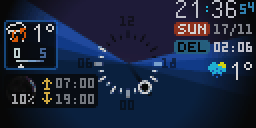

📸 [`export-02.gif`](https://github.com/prashnts/disinfo/blob/8925660/assets/export-02.gif) ([`8925660`](https://github.com/prashnts/disinfo/commit/8925660))

### Added
- Shazam service: songs playing in the room are recognised, with an indicator ([`7e7df28`](https://github.com/prashnts/disinfo/commit/7e7df28) … [`90b3607`](https://github.com/prashnts/disinfo/commit/90b3607)).
- The card stack: widgets register themselves and transition in and out ([`21620e8`](https://github.com/prashnts/disinfo/commit/21620e8) … [`84942a8`](https://github.com/prashnts/disinfo/commit/84942a8)).
- New clock ([`3b095a2`](https://github.com/prashnts/disinfo/commit/3b095a2)). Real temperature ([`2c3675f`](https://github.com/prashnts/disinfo/commit/2c3675f)).

## [2024.07.30] - Pico W panels, aviator

No screenshot for this period.

### Added
- 🔧 **Panels driven by Pico W boards over UDP**: `pico-study`, `pico-3dpanel`, and `pico-salon-a`/`-b`, with the salon split into two 64×64 halves ([`3434318`](https://github.com/prashnts/disinfo/commit/3434318) … [`534c65d`](https://github.com/prashnts/disinfo/commit/534c65d)). The brightness curve was updated to match ([`bc34cac`](https://github.com/prashnts/disinfo/commit/bc34cac) … [`be5cb5c`](https://github.com/prashnts/disinfo/commit/be5cb5c)).
- Aviator: ADS-B Exchange flights overhead, with aircraft icons, flags and a radar map ([`40bc293`](https://github.com/prashnts/disinfo/commit/40bc293) … [`a9829ec`](https://github.com/prashnts/disinfo/commit/a9829ec), [`2a16cf7`](https://github.com/prashnts/disinfo/commit/2a16cf7), [`4103e2b`](https://github.com/prashnts/disinfo/commit/4103e2b) … [`fe7507a`](https://github.com/prashnts/disinfo/commit/fe7507a)).
- Klipper panel, with ETA ([`125f22f`](https://github.com/prashnts/disinfo/commit/125f22f) … [`65ef142`](https://github.com/prashnts/disinfo/commit/65ef142), [`f7495e6`](https://github.com/prashnts/disinfo/commit/f7495e6)).
- Sleep screen ([`0f53887`](https://github.com/prashnts/disinfo/commit/0f53887)). The dishwasher is detected automatically ([`aa54faf`](https://github.com/prashnts/disinfo/commit/aa54faf) … [`eb251d9`](https://github.com/prashnts/disinfo/commit/eb251d9)).

### Changed
- Less data used ([`c9a28e6`](https://github.com/prashnts/disinfo/commit/c9a28e6)).

## [2024.04.13] - Appliances

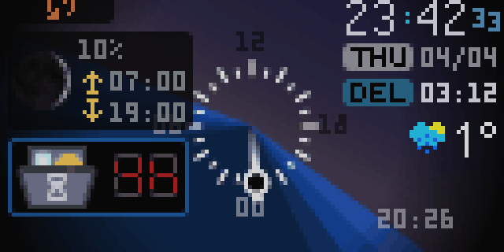

📸 [`export-01.gif`](https://github.com/prashnts/disinfo/blob/2b01825/assets/export-01.gif) ([`2b01825`](https://github.com/prashnts/disinfo/commit/2b01825))

### Added
- Dishwasher card with a segment display ([`a24f7c9`](https://github.com/prashnts/disinfo/commit/a24f7c9) … [`9b4d369`](https://github.com/prashnts/disinfo/commit/9b4d369)).
- 🔧 A `frekvens` renderer that sends frames over MQTT ([`a24f7c9`](https://github.com/prashnts/disinfo/commit/a24f7c9)).
- 🔧 Washing machine detector, for the 3D panel ([PR #1](https://github.com/prashnts/disinfo/pull/1), [`8515c7c`](https://github.com/prashnts/disinfo/commit/8515c7c), 2024-04-21).

## [2023.11.23] - Transitions, trash schedule, card stack, web UI

No screenshot for this period.

### Added
- Transitions and easing ([`6f2c371`](https://github.com/prashnts/disinfo/commit/6f2c371) … [`20d5a2c`](https://github.com/prashnts/disinfo/commit/20d5a2c)).
- Trash collection schedule ([`cad3935`](https://github.com/prashnts/disinfo/commit/cad3935) … [`7517209`](https://github.com/prashnts/disinfo/commit/7517209)).
- First card stack ([`b494ea7`](https://github.com/prashnts/disinfo/commit/b494ea7) … [`1fe3641`](https://github.com/prashnts/disinfo/commit/1fe3641)). Web UI ([`2518778`](https://github.com/prashnts/disinfo/commit/2518778) … [`5f0eb98`](https://github.com/prashnts/disinfo/commit/5f0eb98)).
- 🔧 Panel gamma ([`a429ba5`](https://github.com/prashnts/disinfo/commit/a429ba5)).

### Changed
- Presence and lux sensors migrated to Home Assistant ([`9fb3dd8`](https://github.com/prashnts/disinfo/commit/9fb3dd8) … [`e58d8c3`](https://github.com/prashnts/disinfo/commit/e58d8c3)).

## [2023.09.13] - Spectra temperature graph

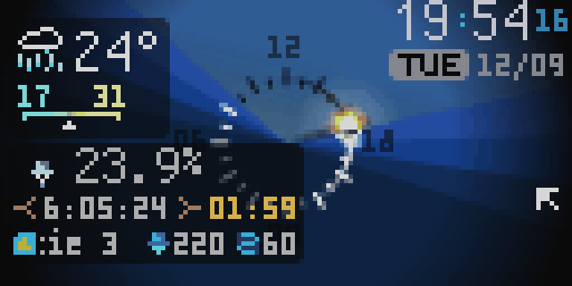

📸 [`disinfo-export.gif`](https://github.com/prashnts/disinfo/blob/5410918/assets/disinfo-export.gif) ([`5410918`](https://github.com/prashnts/disinfo/commit/5410918))

### Changed
- The temperature graph uses the spectra colour scale ([`5410918`](https://github.com/prashnts/disinfo/commit/5410918)). The OctoPrint card was repositioned ([`632e109`](https://github.com/prashnts/disinfo/commit/632e109)).

## [2023.09.09] - Solar clock

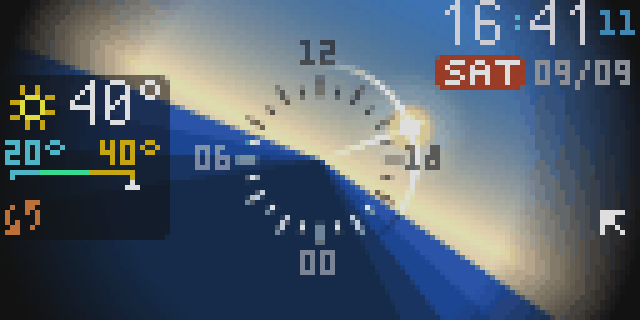

📸 [`disinfo-export.gif`](https://github.com/prashnts/disinfo/blob/a90b48c/assets/disinfo-export.gif) ([`a90b48c`](https://github.com/prashnts/disinfo/commit/a90b48c))

### Added
- **Solar clock**: a 24 h dial with the sun on its path, day and night sky, and a background that reacts ([`351d211`](https://github.com/prashnts/disinfo/commit/351d211) … [`ff2e281`](https://github.com/prashnts/disinfo/commit/ff2e281)).
- Moon phase and sunrise/sunset ([`3caaa57`](https://github.com/prashnts/disinfo/commit/3caaa57) … [`d56babe`](https://github.com/prashnts/disinfo/commit/d56babe)).
- 🔧 Web server, so displays can connect to it, with remote buttons in the web page ([`8a33b75`](https://github.com/prashnts/disinfo/commit/8a33b75), [`3203fa4`](https://github.com/prashnts/disinfo/commit/3203fa4)). Install script ([`7850b70`](https://github.com/prashnts/disinfo/commit/7850b70)).
- Redesigned date and time ([`b0706b7`](https://github.com/prashnts/disinfo/commit/b0706b7) … [`4902194`](https://github.com/prashnts/disinfo/commit/4902194)). New fonts and metro logic ([`76b87b5`](https://github.com/prashnts/disinfo/commit/76b87b5), [`01dcefa`](https://github.com/prashnts/disinfo/commit/01dcefa)).

### Changed
- State moves over Redis pub/sub (sensors, weather, metro), and almost all sync Redis calls are gone ([`d60476c`](https://github.com/prashnts/disinfo/commit/d60476c) … [`712810e`](https://github.com/prashnts/disinfo/commit/712810e)). Pydantic 2 ([`d6aeec9`](https://github.com/prashnts/disinfo/commit/d6aeec9)).

## [2023.06.29] - Styled text, divs, `disinfo`

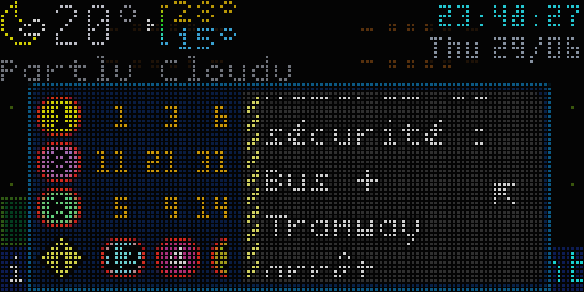

📸 [`disinfo-export.gif`](https://github.com/prashnts/disinfo/blob/3bcf426/assets/disinfo-export.gif) ([`3bcf426`](https://github.com/prashnts/disinfo/commit/3bcf426))

### Added
- Typed state managers ([`3726cec`](https://github.com/prashnts/disinfo/commit/3726cec)). Styled text ([`3080282`](https://github.com/prashnts/disinfo/commit/3080282)). Divs with real rounded corners ([`10c69fe`](https://github.com/prashnts/disinfo/commit/10c69fe), [`c380b31`](https://github.com/prashnts/disinfo/commit/c380b31)). A transition manager for visibility ([`eccac70`](https://github.com/prashnts/disinfo/commit/eccac70)).
- 🔧 RGB matrix emulator, for development without the panel ([`9366994`](https://github.com/prashnts/disinfo/commit/9366994)).

### Changed
- The module was renamed from `disp_info` to `disinfo` ([`4abdc13`](https://github.com/prashnts/disinfo/commit/4abdc13)), along with `hstack`/`vstack`/`mosaic` ([`8a1be79`](https://github.com/prashnts/disinfo/commit/8a1be79)).

## [2023.05.30] - Metro disruptions, Pi 4

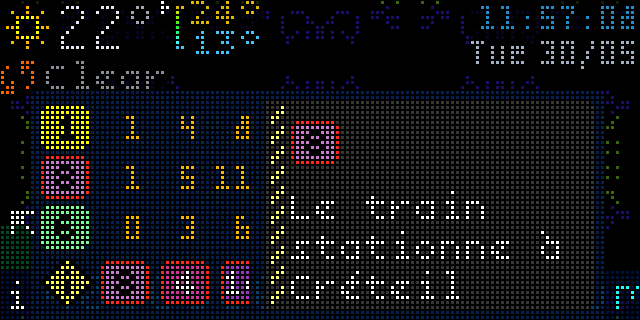

📸 [`disinfo-export.gif`](https://github.com/prashnts/disinfo/blob/0ebe7a8/assets/disinfo-export.gif) ([`0ebe7a8`](https://github.com/prashnts/disinfo/commit/0ebe7a8))

### Added
- Metro disruption messages in multiline text that scrolls when full, with a warning line ([`a5fcc97`](https://github.com/prashnts/disinfo/commit/a5fcc97) … [`c239afc`](https://github.com/prashnts/disinfo/commit/c239afc)).
- Unified state and a debug UI ([`1cbda9f`](https://github.com/prashnts/disinfo/commit/1cbda9f), [`b2a61ed`](https://github.com/prashnts/disinfo/commit/b2a61ed)).
- 🔧 **Raspberry Pi 4** ([`54e57b9`](https://github.com/prashnts/disinfo/commit/54e57b9)), with threaded drawing ([`1be49a8`](https://github.com/prashnts/disinfo/commit/1be49a8) … [`6325e79`](https://github.com/prashnts/disinfo/commit/6325e79)).

## [2023.05.27] - GIF renderer, auto brightness

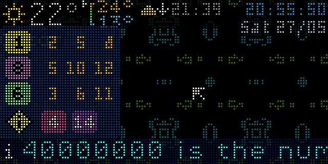

📸 [`disinfo-export.gif`](https://github.com/prashnts/disinfo/blob/766516d/assets/disinfo-export.gif) ([`766516d`](https://github.com/prashnts/disinfo/commit/766516d)). Same day: [`8c58830`](https://github.com/prashnts/disinfo/commit/8c58830), [`2af30bd`](https://github.com/prashnts/disinfo/commit/2af30bd), [`297bfa5`](https://github.com/prashnts/disinfo/commit/297bfa5), [`c9b01f7`](https://github.com/prashnts/disinfo/commit/c9b01f7); and [`85c0e79`](https://github.com/prashnts/disinfo/commit/85c0e79), [`1cbda9f`](https://github.com/prashnts/disinfo/commit/1cbda9f) the next day.

### Added
- **GIF renderer** ([`8c58830`](https://github.com/prashnts/disinfo/commit/8c58830)): the canvas, exported as these milestone GIFs.
- 🔧 Auto brightness from the light sensor ([`d4d7f29`](https://github.com/prashnts/disinfo/commit/d4d7f29)), with a scipy-interpolated curve ([`fefe758`](https://github.com/prashnts/disinfo/commit/fefe758)).
- Multicolour "resonant" Game of Life backgrounds ([`e91cc9b`](https://github.com/prashnts/disinfo/commit/e91cc9b) … [`9ec220a`](https://github.com/prashnts/disinfo/commit/9ec220a)).

### Changed
- Source reorganised into components, screens and renderers ([`4e4f7de`](https://github.com/prashnts/disinfo/commit/4e4f7de) … [`c611bd1`](https://github.com/prashnts/disinfo/commit/c611bd1)).

## [2023.05.20] - Game of Life, Paris Metro, now playing

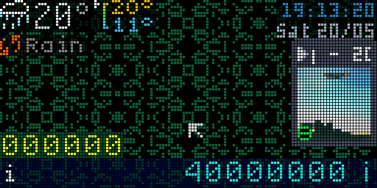

📸 [`demo.png`](https://github.com/prashnts/disinfo/blob/1fd7861/assets/demo.png) ([`1fd7861`](https://github.com/prashnts/disinfo/commit/1fd7861))

### Added
- 🔧 Home Assistant and MQTT services, PIR motion wake-up, and remote input ([`7a73c93`](https://github.com/prashnts/disinfo/commit/7a73c93), [`11504b8`](https://github.com/prashnts/disinfo/commit/11504b8), [`2994481`](https://github.com/prashnts/disinfo/commit/2994481), [`db1158a`](https://github.com/prashnts/disinfo/commit/db1158a)). A second remote ([`4f5ccc6`](https://github.com/prashnts/disinfo/commit/4f5ccc6)).
- Now playing, with dithered album art ([`75c8622`](https://github.com/prashnts/disinfo/commit/75c8622), [`add4c03`](https://github.com/prashnts/disinfo/commit/add4c03)).
- Temperature graph ([`491c403`](https://github.com/prashnts/disinfo/commit/491c403)). 3D printer status from OctoPrint ([`7797e75`](https://github.com/prashnts/disinfo/commit/7797e75)). Plant info ([`a2a78cf`](https://github.com/prashnts/disinfo/commit/a2a78cf)).
- Paris Metro lines and timings ([`944ba43`](https://github.com/prashnts/disinfo/commit/944ba43), [`d4d5c40`](https://github.com/prashnts/disinfo/commit/d4d5c40)).
- Game of Life background ([`d6999ea`](https://github.com/prashnts/disinfo/commit/d6999ea)).
- 🔧 FIFO renderer for several panels ([`a84c283`](https://github.com/prashnts/disinfo/commit/a84c283), [`dad163e`](https://github.com/prashnts/disinfo/commit/dad163e)). FPS limit ([`ff3eab5`](https://github.com/prashnts/disinfo/commit/ff3eab5)).

## [2023.04.22] - First demo

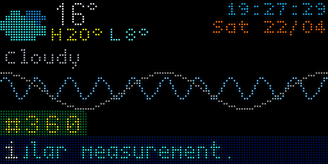

📸 [`demo.png`](https://github.com/prashnts/disinfo/blob/ebd6a9f/assets/demo.png) ([`ebd6a9f`](https://github.com/prashnts/disinfo/commit/ebd6a9f))

### Added
- 🔧 First code ([`6936c3c`](https://github.com/prashnts/disinfo/commit/6936c3c), 2023-04-12): weather and scrolling random facts, drawn with Pillow onto a HUB75 panel through [rpi-rgb-led-matrix](https://github.com/hzeller/rpi-rgb-led-matrix).
- Weather icons, hourly confetti, Scientifica font ([`812b482`](https://github.com/prashnts/disinfo/commit/812b482), [`069850c`](https://github.com/prashnts/disinfo/commit/069850c), [`cedd013`](https://github.com/prashnts/disinfo/commit/cedd013)).
- Data service run by supervisord, using a scheduler ([`3023a23`](https://github.com/prashnts/disinfo/commit/3023a23), [`a727036`](https://github.com/prashnts/disinfo/commit/a727036)).
- Sixel renderer, for development in the terminal ([`cb81597`](https://github.com/prashnts/disinfo/commit/cb81597)).

[Unreleased]: https://github.com/prashnts/disinfo/compare/299bdf0...llm-v1
[2026.08.15]: https://github.com/prashnts/disinfo/compare/5d31841...605e3ea
[2026.03.08]: https://github.com/prashnts/disinfo/compare/5783f4a...5d31841
[2026.02.21]: https://github.com/prashnts/disinfo/compare/60f0eda...5783f4a
[2025.11.16]: https://github.com/prashnts/disinfo/compare/fe583c0...60f0eda
[2025.07.28]: https://github.com/prashnts/disinfo/compare/8925660...fe583c0
[2025.02.07]: https://github.com/prashnts/disinfo/compare/fe7507a...8925660
[2024.07.30]: https://github.com/prashnts/disinfo/compare/2edbdf1...fe7507a
[2024.04.13]: https://github.com/prashnts/disinfo/compare/78a8898...2b01825
[2023.11.23]: https://github.com/prashnts/disinfo/compare/5410918...78a8898
[2023.09.13]: https://github.com/prashnts/disinfo/compare/a90b48c...5410918
[2023.09.09]: https://github.com/prashnts/disinfo/compare/3bcf426...a90b48c
[2023.06.29]: https://github.com/prashnts/disinfo/compare/0ebe7a8...3bcf426
[2023.05.30]: https://github.com/prashnts/disinfo/compare/766516d...0ebe7a8
[2023.05.27]: https://github.com/prashnts/disinfo/compare/1fd7861...766516d
[2023.05.20]: https://github.com/prashnts/disinfo/compare/ebd6a9f...1fd7861
[2023.04.22]: https://github.com/prashnts/disinfo/compare/6936c3c...ebd6a9f
