## disinfo: the design system

This is a tour of the pieces disinfo screens are made of: layouts, stacks, type,
boxes, motion, scrolling, media and touch. Most of it lives in `discore` (`libs/discore`); the media
helpers (icons, images, streams) are in `disinfo/utils`.

There's a live version of this page on the display itself. Turn on `show_design_demo`
from the web remote and it takes the screen below the time. The tabs and the page
numbers are touch targets; the pages cycle by themselves, and a touched page number
stays until you touch it again. When there's room, the next pages are shown under it. The code is in `disinfo/apps/design_demo.py`, and
each section below names the page it's on.

Everything is immediate-mode: a composer function runs every frame and returns a
`Frame`, an image plus a hash. Equal hashes mean the same picture, which is what the
caches and transitions go by. Frames you build with `text`, `div`, `hstack` and so on
are hashed for you. A frame from somewhere else gets a token that's only equal to
itself, unless you `tag` it.


### Flex

`hstack` and `vstack` place frames in a row or a column with a `gap` and an `align`.
For plain frames that's all they do. Give them a `Box`, a `Spacer`, a width or a
stretch alignment, and they lay out like CSS flex: constraints go down, sizes come up.

- `Spacer()` takes the free space. One at the start pushes the rest to the end, two
  around them centers them, one between each spreads them out.
- A `Box` with `grow` takes a share of the free space, `Grow(frame)` does it for any frame.
- `text(..., overflow='fit')` cuts the text to the room left; `'wrap'` breaks it into
  lines, up to `max_lines`.

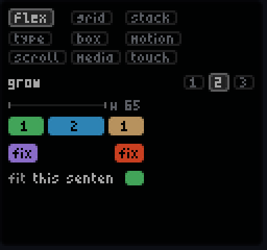

```python
row = hstack([
    text('fit', label_style),
    text('this sentence gets cut to the room left', body_style, overflow='fit'),
    icon,
], gap=3)

# The row is laid out in the width the div gives it.
card = div(vstack([head, row], gap=4, align='hstretch'), width=w)
```

A custom element is a `Box`: it says how big it wants to be in `measure`, and draws
at the size it got in `render`. The demo's `Ring` and `Sparkline` are examples.

```python
class Ring(Box):
    def __init__(self, value: float, color: str, size: int = 18):
        self.value, self.color, self.size_ = value, color, size
        self.hash = ('Ring', round(value, 2), color, size)

    def measure(self, max_w: int, max_h: int) -> tuple[int, int]:
        d = min(self.size_, max_w, max_h)
        return d, d

    def render(self, w: int, h: int) -> Frame:
        ...
```

Demo: `flex` tab (spacer, grow, shapes); `type` tab, wrap.


### Grid

`grid` takes `ncols` and/or `nrows`. Give one and the other follows from the count;
give neither and it's about square. Each column is as wide as its widest item, each
row as tall as its tallest. With `masonry` there are no rows: each item goes under the
shortest column. With a `width` the columns share it, growers fill their cell and the
rest gets clipped. `anchor` places an item in its cell.

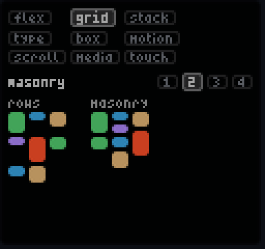

```python
grid(cells, ncols=3, gap=2)
grid(cells, ncols=3, gap=2, masonry=True)
grid(cells, ncols=3, gap=2, width=w, height=30, anchor='br')
```

Demo: `grid` tab.


### Stack

The side and bottom cards are a `Stack` of `Widget`s. It scrolls to the card on top,
and after that card's `wait_time` goes on to the one shown least lately, so over time
each gets about its `share`. A card with `focus` is put on top and stays there; the
printer card does it when a print starts or ends. A new card gets a turn right away.

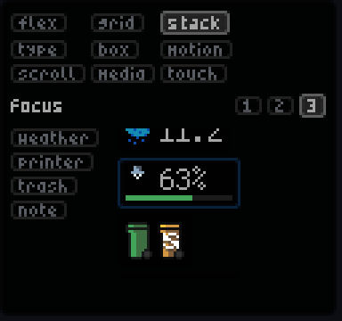

```python
cards = [
    Widget('weather', weather_frame, wait_time=5),
    Widget('printer', printer_frame, priority=2, focus=just_started),
]
side = Stack('main_cards', StackStyle(size=fs.config.height)).mut(cards).draw(fs)
row = Stack('bottom_cards', StackStyle(size=fs.config.width, horizontal=True, offset_top=0)).mut(cards).draw(fs)
```

Demo: `stack` tab (column, row, focus). On focus, touch a card's name to give it focus.


### Type

`text(value, style)` with a `TextStyle`: font, color, outline. Fonts are in
`disinfo/fonts.py`, pixel fonts drawn at their own size. The ones used most are
`microfont_35_reg` (5 px) for labels, `bitocra7` for values and `cozette` for big
numbers. Some come in weights: `scientifica__r/b/i`, `px_op__l/lb`, `mecha`,
`mecha_bold`, `mecha_cond`.

The LEDs blow out light tones, so the greys stop at `#a6a6a6` (`#5b5e64` dim,
`#808080` muted) and the colors are muted. Text on a color reads best dark (`#000000`):
unlit pixels.

Outlines keep text readable over something busy. They only work on TTF fonts, not
on the bitmap (`.bdf`) ones.

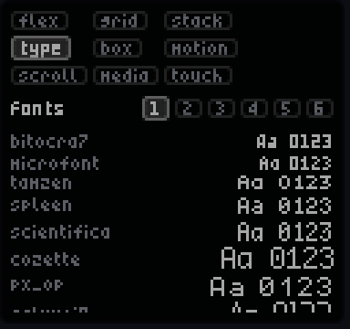
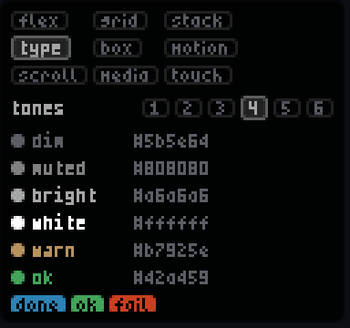

```python
value_style = TextStyle(font=fonts.bitocra7, color='#a6a6a6')
pill = div(text('done', TextStyle(font=fonts.microfont_35_reg, color='#000000')), padding=(1, 2, 1, 2), radius=2, background='#2d83b4')

text('Constraints go down, sizes come up.', body_style, overflow='wrap', max_lines=4)
text('outline 1', TextStyle(font=fonts.greybeard, outline=1, outline_color='#000000'))
```

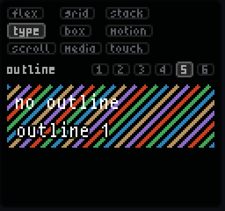

Demo: `type` tab (fonts, sizes, weights, tones, outline, wrap).


### Boxes

`div` is the box: padding, margin, radius, border, background. All of `DivStyle` can be
passed as keywords too. With a `width`/`height` it's a fixed box and `anchor` places
the content in it. `background_frame` puts an image behind, filled.

`frost` blurs what's under a frame when it's placed with `composite_at` or `place_at`,
by the radius given. The cards on the screen use it so the background stays readable
through them.

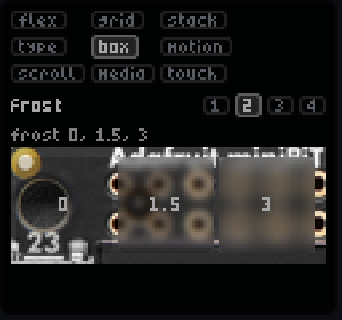

```python
div(text('done', dark_style), padding=(1, 2, 1, 2), radius=2, background='#2d83b4')

# An image behind, the text on a scrim at the bottom.
scrim = div(info, padding=(1, 2, 1, 2), background='#000000a0', width=w - 4)
div(scrim, width=w, height=h, radius=3, anchor='bl', background_frame=photo)

image = composite_at(card, image, 'mm', frost=1.5)
progress_bar(0.6, ProgressStyle(width=w, height=4, radius=2, color='#2d83b4'))
```

Note the `width` on the scrim: without it, a div around a row with a `Spacer` is
sized by its parent, and here it would cover the whole image.

Demo: `box` tab (div, frost, image, bars).


### Motion

Transitions run when their value changes, and a value is a frame, so it changes when
its hash does. Each one keeps its state under its name. If a live frame changes on
every draw (a camera, a breathing width), `tag` it with what should restart the
transition.

- `FadeIn`, `SlideIn` (from an edge), `ScaleIn`, and `Resize`, which goes between sizes.
- `Slides` cycles frames, each for its own time, and fades between them. With
  `edge='bottom'` and no height it's a ticker: each line rolls up, and the box is as
  tall as the line that's on.
- `text_slide_in` slides each character in when it changes. Give it a `name`, it keeps
  its state under it. By default the way the value went picks the edge: higher comes in
  from the top, lower from the bottom. `edge` is that pair, `(up, down)`, or one edge
  for always: the clocks use `'top'`, so midnight doesn't run backwards. Text that isn't
  a number keeps the way it went last.
- `SlideIn(...).mut(frame, edge)` takes the edge for each new value; a frame on its
  way keeps the one it had.
- `NumberTransition` eases a number; draw whatever you want with it.

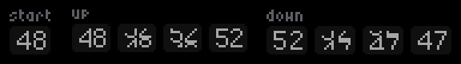
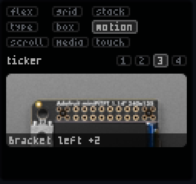

```python
chip = div(text(str(v), dark_style), width=12, height=9, radius=2, background=color).tag(('chip', v))
SlideIn('chip.up', 0.4, ease.cubic.cubic_out, edge='bottom').mut(chip).draw(fs)

lines = Slides('ticker', SlidesStyle(width=w, edge='bottom')).mut([
    (lambda: stage_line, 14),
    (lambda: job_line, 6),
]).draw(fs)

text_slide_in(fs, f'{round(temp)}', style, name='nozzle')      # up from the top, down from the bottom
text_slide_in(fs, fs.now.strftime('%H:%M:%S'), big_style, 'top', name='clock')
v = NumberTransition('gauge', 1.2, ease.cubic.cubic_in_out, initial=0).mut(target).value(fs)
```

Demo: `motion` tab (transitions, digits, ticker, number).


### Scroll

`HScroller` and `VScroller` move what doesn't fit through a window of `size` px, and
leave it alone when it fits. `speed` is the seconds per step and `delta` the px per
step. Other options:

- `pause_at_loop` stops at the start each time round.
- `pauses` are px in the content to stop at, for `pause_duration` each. It's a line
  at a time if they're the lines' tops.
- `set_target(px)` scrolls there and stays. That's how a `Stack` gets to its card.
- `scrollbar` draws one.

Touch targets scroll with the content.

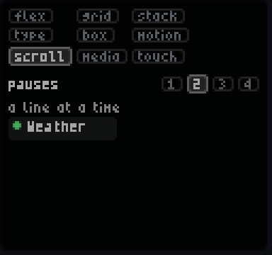

```python
HScroller(size=40, name='title', pause_at_loop=True).set_frame(text(title, style)).draw(fs.tick)

ys = [sum(r.height + 3 for r in rows[:i]) for i in range(len(rows))]
VScroller(size=rows[0].height, name='news', pause_duration=1.2).set_frame(vstack(rows, gap=3), pauses=ys, pause_offset=0).draw(fs.tick)
```

Demo: `scroll` tab (marquee, pauses, vertical, target).


### Media

- `StillImage(path)` is a PNG. Most icons in `assets/raster` are drawn in Aseprite at
  their pixel size, the `.aseprite` files are next to them.
- `SpriteIcon(path, step_time)` animates a vertical strip of square frames, or a GIF.
- `load_svg(path, scale)` renders an SVG with cairo; `mdi.icon(name, size, color)`
  renders a Material Design Icon by name. It downloads the icon once and keeps it in
  `assets/mdi`, and returns None until it's there.
- `get_icon_for_condition` draws the weather icons pixel by pixel.
- `image_from_url(url, resize)` fetches an image. A failed fetch isn't cached but is
  retried at most every 30 s.
- `MJPEGStream(url).read(w, h)` is the latest frame of a camera stream, decoded at the
  size asked. It reads in the background while something draws it.

Every frame has `opacity`, `brightness`, `contrast`, `color_`, `rotate`, `resize` and
crops, each returning a new frame.

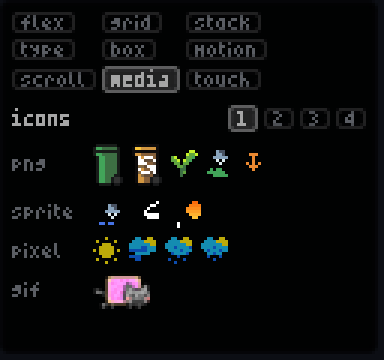

```python
nozzle = SpriteIcon('assets/raster/nozzle-alt-9x9.png', step_time=0.1)
bulb = mdi.icon('lightbulb', 12, '#b7925e')

hstack([nozzle.draw(fs.tick), bulb, StillImage('assets/raster/plant-9x9.png')], gap=3)
view = MJPEGStream(url).read(80, 48)        # None while it connects
cover.resize((24, 24), ratio_fn=min).color_(0.6).brightness(0.8)
```

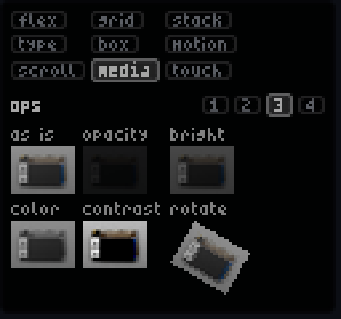

Demo: `media` tab (icons, vector, ops, stream). The stream page shows `stream_url`
from the remote, or the first of `printer_streams`.


### Touch

A `button` is a div with a touch target: an action and a payload. Targets travel with
the frame through the layouts, scrollers and transitions (not while a transition moves
them). The web page and the ESP displays send touches to the server, which finds the
target under the touch and publishes its action on release, like a remote button. A
target with `hold` acts once the touch has stayed on it that long. `TouchStateManager`
tells you if a target is pressed and for how long, so you can draw that.

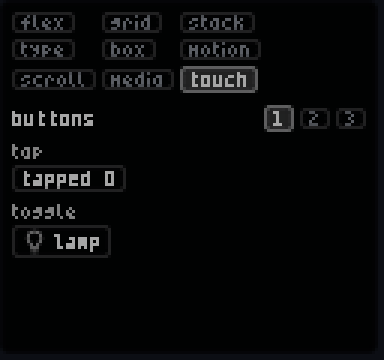

```python
def toggle(fs: FrameState, label: Frame, payload: dict, hold: float = 0) -> Frame:
    touch = TouchStateManager()
    return button(label, 'design_demo', payload, pressed=touch.is_pressed(fs, 'design_demo', payload),
                  hold=hold, progress=hold and touch.held_for(fs, 'design_demo', payload) / hold)
```

The action lands in `RuntimeStateManager.process_message` (`disinfo/drat/app_states.py`),
where the demo merges the payload into its state:

```python
case 'design_demo':
    self.state.design_demo = {**self.state.design_demo, **data.payload}
```

Demo: `touch` tab (buttons, hold, scrolled).


### Putting it on the screen

`Widget` wraps a frame so it can go on a `Stack` of cards (the side and bottom
stacks), with a transition when it appears and disappears. The demo is a widget too,
placed by the compositor in the rows the time leaves (`below_time` in
`compositor.py`).

```python
def design_demo_app(fs: FrameState, size: tuple[int, int]) -> Widget:
    return Widget('di.designdemo', composer(fs, size[0] - 10, size[1] - 10),
                  style=DivStyle(padding=4, radius=3, background='#000000e0', border=1, border_color='#ffffff20'))

image = below_time(fs, design_demo_app, layout, items, image)
```
